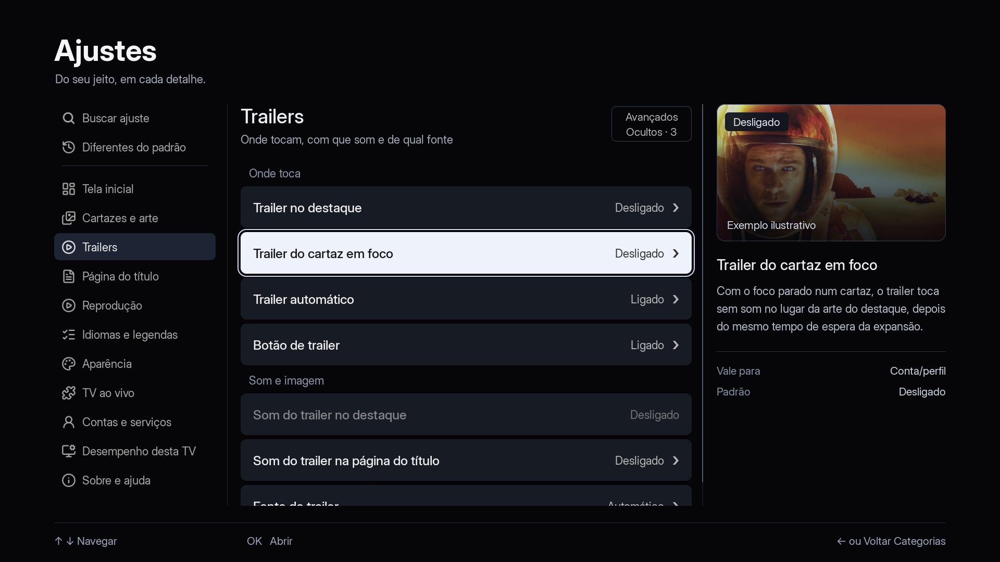
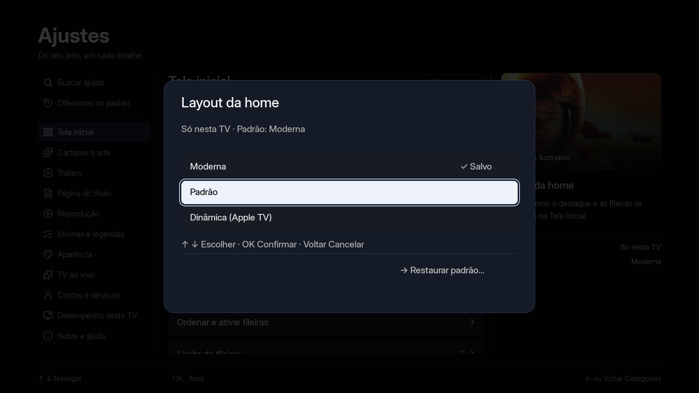

# Review of Native Settings — 10/02/2026

C/SDL/OpenGL implementation in worktree `agent/ajustesux`, based on merge
`2ab3ccc8`. Host captures in 1920×1080, with Inter font and local fixtures.
No account connected. Not photographs or tests of a physical TV.

## Visual Reference

The [mockup approved as direction](../../prototypes/settings-ux/preview.png)
guides the composition. The native revision restores typographic hierarchy,
bordered focus, slate blue surfaces, inspector header image, and
compact advanced toggle. Retains all 11 app categories.





## States to Review

| Scene | Capture |
|---|---|
| Category navigation | [Index](indice.png) |
| Selected option | [Home screen](tela-inicial.png) |
| Mockup category | [Trailers](trailers.png) |
| Cancellable selection | [Selector](seletor.png) · [Trailer](trailer-seletor.png) |
| Dependency without auto-enable | [Requirement](dependencia.png) |
| Non-default factory values | [Differences](diferencas.png) |
| Confirmation with Cancel focused | [Reset](restaurar.png) |
| Revealed advanced option | [Advanced](avancados.png) |
| Numeric editing | [Number](numero.png) |
| Focus on advanced toggle | [Header](cabecalho.png) |
| English text | [English](english.png) |
| Fixed sidebar | [Fixed bar](barra-fixa.png) |

The artwork is the same local prototype sample, identified as illustrative.
Does not represent live playback or preview on actual Home screen. The red
in the reset view is the accent color chosen in the test fixture; not a new error code.

## Verification

Passed in this revision: `ajustes_ux_dados.sh`, `ajustes_ux_interacao.sh`,
`ajustes_secoes.sh`, `i18n.sh`, `spotlight_shot.sh` and GL captures. Previous
integration also passed defaults, profiles, safe mode, disk language, interface
font, and trailer source. These are local host results.

Tests cover search without credentials, scope by value, immutable defaults,
draft/OK/Back, individual reset, write failures, concurrent mutations,
dependencies, query return with restored focus, and absence of history in
dedicated search. 28-language tables are aligned; new copy includes
EN/ES, with fallback for languages awaiting translation review.

An initial run of the new interaction test wrote the marker
`ajustes-locais.txt` to the host Mac installation. The test was fixed to set
`NUVIO_DADOS`, verify the active directory, and isolate subsequent runs.
Previous contents of that marker were neither assumed nor erased.

To reproduce captures from worktree root:

```bash
NUVIO_AJUSTES_UX=1 bash tests/ajustes_shot.sh /tmp/nuvio-ajustes-revisao
```

Still pending: testing on physical TVs / remotes, semantic accessibility,
and measurement of cadence, latency, and memory. Live preview with timeout,
performance presets, island, and renderer optimizations are subsequent proposals,
detailed in [UX direction](../../ux-direction.md).
