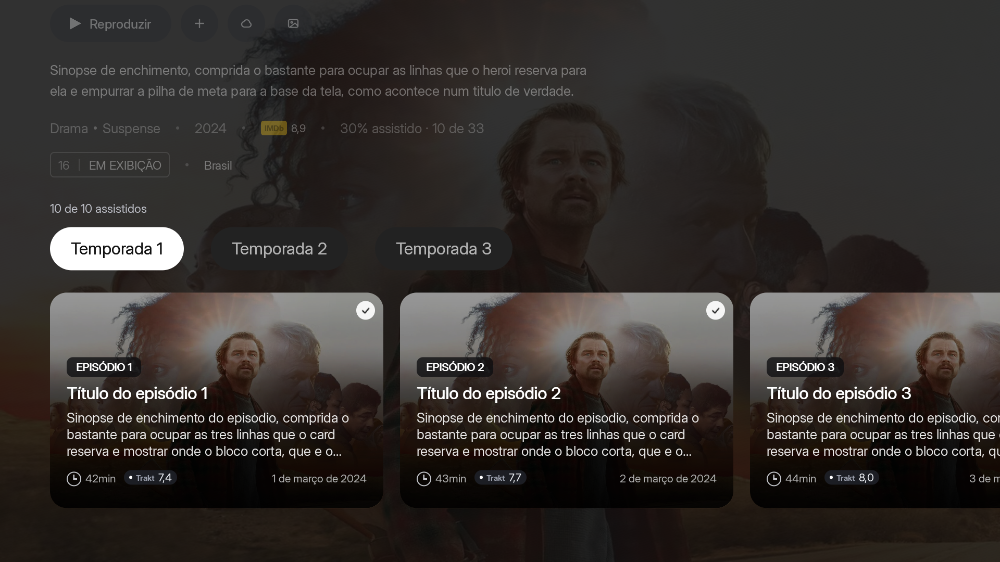
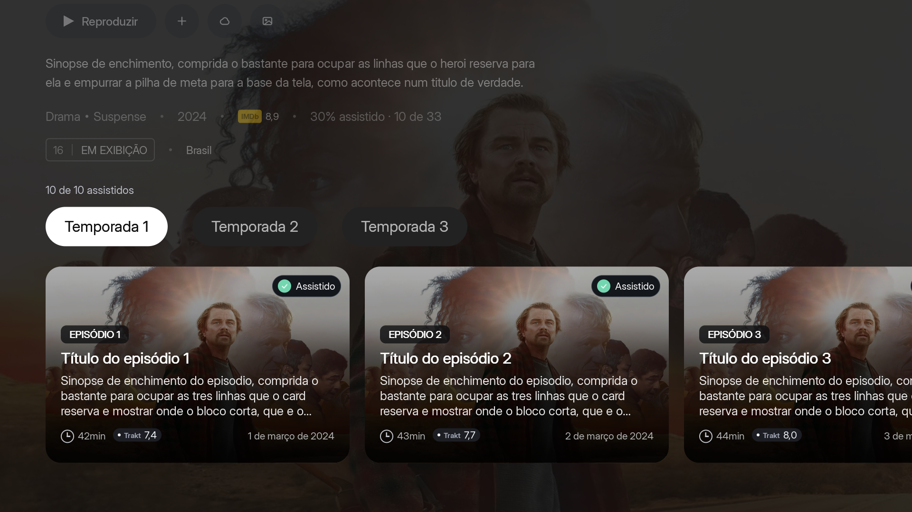
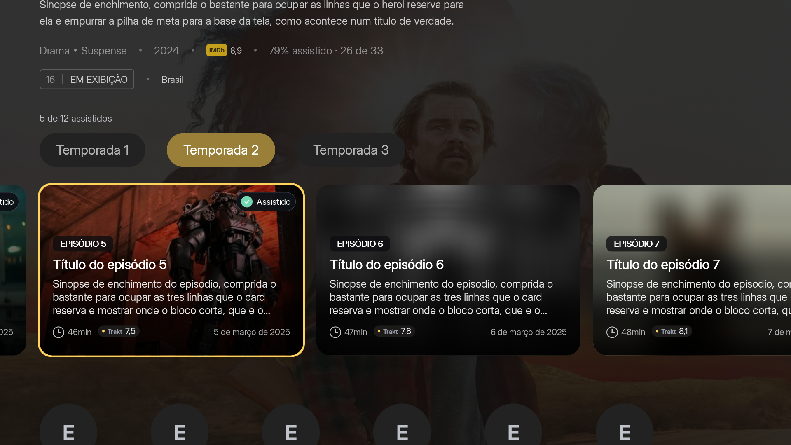

# Watched Episodes — Visual Review

The isolated circle was replaced by a compact "Watched" badge, featuring a jade circle, white checkmark, white text, dark rounded pill, and subtle outline, following the approved mockup. The thumbnail dimming wash was reduced from 22% to 12%, preserving more of the artwork. Focus remains on the thumbnail border outline.

State uses the same history source as the menu; unknown history receives no badge. Text utilizes existing translation and constrains badge width. Zero modifications to persistence or navigation.

## Comparison

## Verification

- `bash tests/detail_eps.sh`: passed.
- `bash tests/detail_eps_shot.sh /tmp/nuvio-episodios-jade`: execution completed, capturing history states, focus, seasons, future episodes, and blur.
- `python3 tools/varredura-i18n.py`: zero untranslated occurrences.
- `git diff --check`: passed.

Captures from native renderer on host with test data. Appearance and performance on physical TV hardware still need verification.
